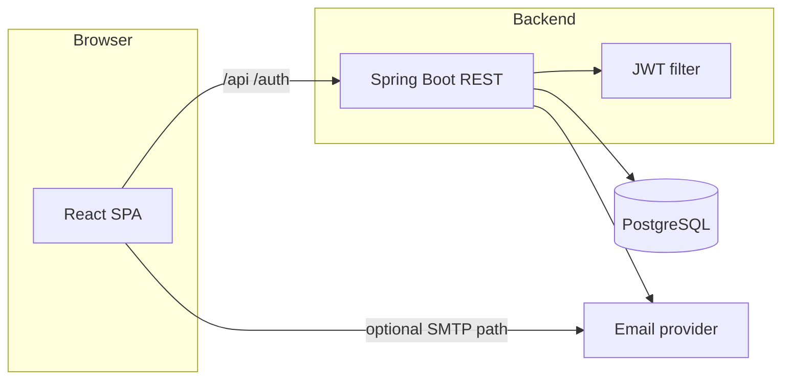

# Architecture

## System context

In local development, the Vite dev server proxies API traffic to `localhost:8080`, so the SPA can use relative URLs. In production, the static frontend calls the API via `VITE_API_BASE_URL`.

## Authentication flow

1. Client posts to `/auth/otp/generate-otp` with a **login ID** (`USR…`, `EMP…`, or `CST…`).
2. `OtpService` resolves the principal (user, employee, or customer entity), stores an OTP, and emails it if mail is enabled; otherwise logs it.
3. Client posts to `/auth/otp/verify-otp` with the same ID and OTP code.
4. On success, the API returns a **JWT**. The frontend stores it in `localStorage` and attaches it on each Axios request (`frontend/src/api/client.ts`).
5. `JwtRequestFilter` validates the token and populates Spring Security context for protected routes.

Public endpoints: `/auth/otp/**`, `/api-docs/**`. Customer and employee URL prefixes under `/api/auth` have additional role checks; all other `/api/**` routes require authentication.

## Domain model (conceptual)

| Concept | Description |
|---------|-------------|
| **User** | Core identity (email, phone, name); admins are flagged on the user row |
| **Customer** | `CST…` id linked to a user; owns **connections** |
| **Employee** | `EMP…` id linked to a user; staff operations |
| **Connection** | Supply point for a customer, typed by **connection type**, with status and dates |
| **Connection type** | e.g. Residential, Commercial |
| **Tariff** | Unit bands (`min_units`–`max_units`) and `rate_per_unit` per connection type |
| **Invoice** | Billing document for a connection; amount derived from usage and tariffs |
| **Payment** | Accounts, UPI IDs (encrypted), cards; **transactions** record transfers and invoice settlement |

Invoice payment can flow through billing (`/api/billing/connections/invoices/payment/upi`) or generic UPI payment APIs under `/api/payments`.

## Backend layout

Package root: `com.ebilling`.

| Package | Responsibility |
|---------|----------------|
| `controllers` | REST adapters (`UserController`, `BillingController`, `PaymentController`, `OtpController`) |
| `services` | Business logic (auth, billing, payment, notification) |
| `repositories` | Spring Data JPA |
| `models` | JPA entities |
| `dtos` | Request/response shapes and validation |
| `configs` | Security, Swagger, dev seeds (`DevSeedLoginHint`, `DevPaymentSeed`) |
| `filters` | JWT and request logging |
| `exceptions` | Typed errors + `GlobalExceptionHandler` |
| `utils` | JWT, OTP, encryption, PDF, CSV |

**Schema evolution:** Hibernate `ddl-auto: update` applies entity changes; **Liquibase** (`src/main/resources/db/changelog/`) owns versioned changes and optional **`seed-dev`** data. Production should rely on Liquibase and treat Hibernate DDL policy according to your deployment standards.

**Profiles:**

- `application.yml` — shared config, env-driven datasource and secrets
- `application-local.yml` — `seed-dev` Liquibase context, mail disabled by convention
- `application-prod.yml` — CORS from `CORS_ALLOWED_ORIGINS`
- `application-test.yml` — H2, Liquibase off

## Frontend layout

| Path | Purpose |
|------|---------|
| `src/features/` | Route-level pages grouped by role (`admin`, `employee`, `customer`, `auth`) |
| `src/routes/` | Router, path constants, nav config, `ProtectedRoute` |
| `src/api/` | Axios client and API modules |
| `src/hooks/queries`, `hooks/mutations` | TanStack Query wrappers |
| `src/components/` | Shared UI and `DashboardLayout` |
| `src/contexts/` | Auth session |
| `src/auth/` | Token/session helpers |

Role routing:

- `/admin/*` — `ADMIN`
- `/employee/*` — `EMPLOYEE`
- `/customer/*` — `CUSTOMER`

`ProtectedRoute` enforces JWT presence and role membership before rendering the dashboard shell.

## Billing calculation (high level)

1. Staff creates an invoice for a **connection** with meter readings or units for a period.
2. `InvoiceService` / `TariffService` select applicable **tariff** rows for the connection’s type and unit count.
3. Invoices expose status (e.g. pending vs paid) for customer bill lists and staff reporting.
4. Payment updates invoice state and records **payment transactions** for history views.

Exact formulas and edge cases live in `InvoiceService` and related billing services; refer to those classes when changing pricing rules.

## Security notes

- JWT secret and encryption keys must be strong and unique per environment; never commit `backend/.env`.
- UPI PINs and similar fields are stored encrypted (`EncryptionUtil`).
- CSRF is disabled because the API is stateless JWT-based; protect origins in production via CORS.
- Payment flows in this project simulate a payment gateway for demonstration; they are not production PCI-compliant integrations.

## Extension points

- **New roles or routes:** extend `UserRole`, JWT claims, `SpringSecurity` matchers, and frontend `ProtectedRoute` / `router.tsx`.
- **New billing rules:** tariffs and `TariffService`; consider Liquibase seeds for local testing.
- **Real notifications:** enable `APP_MAIL_ENABLED` and configure `MAIL_*`; optional SMS would be a new channel in `OtpService`.
- **Real payments:** replace or wrap `UpiService` / card flows with a provider SDK and webhook handling.
